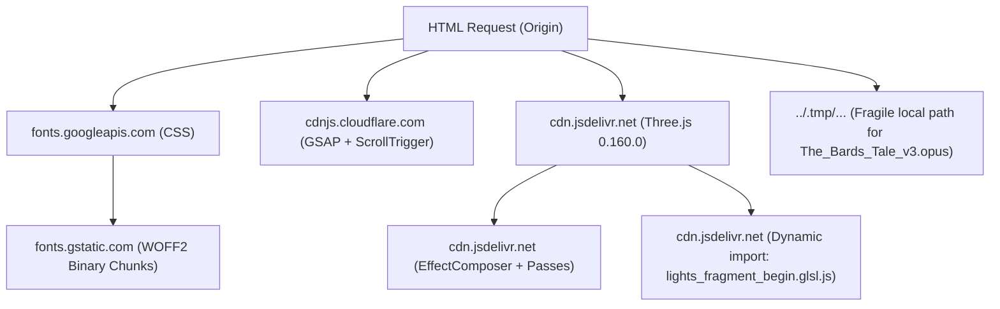

# Eliminating Third-Party Asset Waterfalls & Achieving Predictable Load Times

Engineering reference for transitioning external CDN dependencies (fonts, Three.js modules, GSAP, audio) to deterministic, self-hosted repository assets with sub-second predictable delivery.

---

## 1. Audit of Current Third-Party Waterfall Dependencies

The prototype currently relies on a multi-domain external network waterfall across four distinct external origins:



### Measured Points of Failure & Latency Tax

1. **Google Fonts Multi-RTT Bottleneck**:
   - `prototype/index.html` connects to `fonts.googleapis.com` for CSS and `fonts.gstatic.com` for font binaries.
   - Requires **two separate DNS lookups**, **two TCP handshakes**, and **two TLS negotiations** (200–500ms cumulative latency penalty on mobile / high-RTT connections).
   - Generates ~30 `@font-face` declarations across Unicode ranges (Cyrillic, Greek, Vietnamese, Latin). The browser discovers text nodes during layout and initiates font downloads late in the critical rendering path, causing noticeable FOIT (Flash of Invisible Text) or layout shift.
2. **Three.js CDN Import Map & Dynamic Shader Chunk**:
   - Pinned import map in `index.html` routes `"three"` and `"three/addons/"` to `cdn.jsdelivr.net`.
   - **Critical Runtime Flaw**: In `prototype/scene.js:752`, the custom wax SSS material executes a runtime dynamic import:
     ```javascript
     import("https://cdn.jsdelivr.net/npm/three@0.160.0/src/renderers/shaders/ShaderChunk/lights_fragment_begin.glsl.js")
     ```
     This triggers an asynchronous HTTP request over the public internet during scene boot, stalling material compilation until jsdelivr responds.
3. **Third-Party CDN Risk (cdnjs & jsdelivr)**:
   - External CDNs are subject to regional routing latency, CDN cache misses, corporate firewall / ISP blocking, and aggressive privacy extensions (e.g. uBlock Origin, Privacy Badger) that block CDN tracking or script injection.
   - Browser connection pooling cannot multiplex HTTP/2 or HTTP/3 streams across differing hostnames (`cdnjs`, `jsdelivr`, `googleapis`, `gstatic`).
4. **Fragile Audio Path**:
   - In `prototype/app.js:290`, audio is fetched from `"../.tmp/pen-runs/assets/The_Bards_Tale_v3.opus"`.
   - `.tmp/` is gitignored. In production deployments (e.g. GitHub Pages or static web servers), this path 404s, silently breaking the primary musical experience and forcing fallback to the procedural harp.

---

## 2. Step-by-Step Asset Localization Strategy

All third-party assets must be downloaded directly into the repository following the established licensing constraints (**ADR-0004: CC0 / OFL / MIT / ISC only**).

### A. Font Self-Hosting (OFL 1.1)

Download only the required Latin and Latin-Ext subsets for the three typography voices into `assets/fonts/`:

| Font Family | Style / Weight | Required Subsets | License | Est. Size (WOFF2) |
| :--- | :--- | :--- | :--- | :--- |
| **Cinzel Decorative** | Regular (400), Bold (700) | Latin | SIL OFL 1.1 | ~18 KB each |
| **Fondamento** | Regular (400), Italic (400) | Latin, Latin-Ext | SIL OFL 1.1 | ~22 KB each |
| **EB Garamond** | Regular (400), Medium (500), Italic (400) | Latin, Latin-Ext | SIL OFL 1.1 | ~28 KB each |

**Implementation Pattern in `styles.css`**:
```css
@font-face {
  font-family: 'EB Garamond';
  font-style: normal;
  font-weight: 400;
  font-display: swap;
  src: url('./assets/fonts/eb-garamond-v33-latin-regular.woff2') format('woff2');
  unicode-range: U+0000-00FF, U+0131, U+0152-0153, U+02BB-02BC, U+02C6, U+02DA, U+02DC, U+0304, U+0308, U+0329, U+2000-206F, U+20AC, U+2122, U+2191, U+2193, U+2212, U+2215, U+FEFF, U+FFFD;
}
```

**Head Preload for LCP Hero Font**:
```html
<link rel="preload" href="assets/fonts/eb-garamond-v33-latin-regular.woff2" as="font" type="font/woff2" crossorigin>
```

### B. Self-Hosting Three.js & Post-Processing Addons (MIT)

Download pinned Three.js r160 core and required JSM modules into `vendor/three/`:

- `vendor/three/three.module.min.js` (r160)
- `vendor/three/addons/postprocessing/EffectComposer.js`
- `vendor/three/addons/postprocessing/RenderPass.js`
- `vendor/three/addons/postprocessing/ShaderPass.js`
- `vendor/three/addons/postprocessing/UnrealBloomPass.js`
- `vendor/three/addons/postprocessing/OutputPass.js`
- `vendor/three/addons/shaders/CopyShader.js`
- `vendor/three/addons/shaders/LuminosityHighPassShader.js`
- `vendor/three/shaders/lights_fragment_begin.glsl.js`

**Refactored Import Map (`index.html`)**:
```html
<script type="importmap">
{
  "imports": {
    "three": "./vendor/three/three.module.min.js",
    "three/addons/": "./vendor/three/addons/"
  }
}
</script>
<link rel="modulepreload" href="./vendor/three/three.module.min.js">
```

**Shader Chunk Inline Elimination (`scene.js:752`)**:
Instead of a dynamic network fetch `import("https://cdn.jsdelivr.net/...")`, import the shader chunk locally or resolve it directly from `THREE.ShaderChunk.lights_fragment_begin`, eliminating all runtime network overhead.

### C. Self-Hosting GSAP & ScrollTrigger (GreenSock Standard License)

Download `gsap.min.js` (3.13.0) and `ScrollTrigger.min.js` (3.13.0) into `vendor/gsap/`:
```html
<script src="./vendor/gsap/gsap.min.js"></script>
<script src="./vendor/gsap/ScrollTrigger.min.js"></script>
```

### D. Audio Track Relocation (CC0)

Move `The_Bards_Tale_v3.opus` (482 KB, CC0 per research and ADR-0004) to tracked repository storage:
- Relocate to `assets/audio/The_Bards_Tale_v3.opus`.
- Update `app.js:290`:
  ```javascript
  fetch("./assets/audio/The_Bards_Tale_v3.opus")
  ```

---

## 3. Predictable Load Times & Cache Architecture

Consolidating all assets onto the same origin transforms the network lifecycle:

### 1. HTTP/2 & HTTP/3 Single-Connection Multiplexing
- **Zero Cross-Origin Handshakes**: DNS and TLS are resolved once for the host origin. All assets stream over a single persistent TCP or QUIC connection.
- **Header Compression (HPACK / QPACK)**: Redundant request headers are compressed, reducing packet overhead across initial bursts.

### 2. Cache Permanence Strategy
- **Immutable Vendor Assets**: Static vendor scripts (`vendor/**`) and font binaries (`assets/fonts/**`) do not change between feature deploys.
- **Cache Directives**:
  ```http
  Cache-Control: public, max-age=31536000, immutable
  ```
- **Application Files**: Dynamic files (`app.js`, `scene.js`, `styles.css`) continue using monotonic version query tokens (`?v=53`) or content hashing.
- **Repeat Visit Predictability**: Return visits load all vendor scripts, textures, and fonts from disk cache in $0\text{ ms}$ network time, leaving the network interface entirely free for audio streaming.

---

## 4. Expected Performance Impact

| Metric | Current (External CDNs) | Projected (Self-Hosted Single Origin) | Lever |
| :--- | :--- | :--- | :--- |
| **External Origins** | 4 domains (`googleapis`, `gstatic`, `cdnjs`, `jsdelivr`) | **0 external domains** (1 host origin) | Zero external DNS / TLS handshakes. |
| **Critical Connection Overhead** | ~350–700 ms | **0 ms** (re-uses initial connection) | HTTP/2 multiplexing. |
| **Material Compile Stall** | 100–350 ms (runtime jsdelivr import) | **0 ms** (bundled / local shader chunk) | Inlined shader patch. |
| **Font Render Delay** | FOIT visible (wait on CSS + gstatic chunk) | **Zero FOIT** (`preload` + local WOFF2) | Direct font preloading. |
| **Offline / Firewall Resilience** | Fails if CDN or Google Fonts is blocked | **100% resilient** | Fully contained self-sufficient bundle. |

---

## 5. Primary References

- **WHATWG HTML Living Standard**: [Import Maps](https://html.spec.whatwg.org/multipage/webappapis.html#import-maps) · [Link types: modulepreload](https://html.spec.whatwg.org/multipage/links.html#link-type-modulepreload) · [Link types: preload](https://html.spec.whatwg.org/multipage/links.html#link-type-preload)
- **W3C Web Fonts**: [CSS Fonts Module Level 4 (`font-display`)](https://www.w3.org/TR/css-fonts-4/#font-display-desc) · [WOFF File Format 2.0](https://www.w3.org/TR/WOFF2/)
- **IETF RFCs**: [RFC 9114: HTTP/3](https://www.rfc-editor.org/rfc/rfc9114.html) · [RFC 8246: HTTP Immutable Responses](https://www.rfc-editor.org/rfc/rfc8246.html)
- **Three.js Repository**: [ShaderChunk lights_fragment_begin](https://github.com/mrdoob/three.js/blob/r160/src/renderers/shaders/ShaderChunk/lights_fragment_begin.glsl.js)
