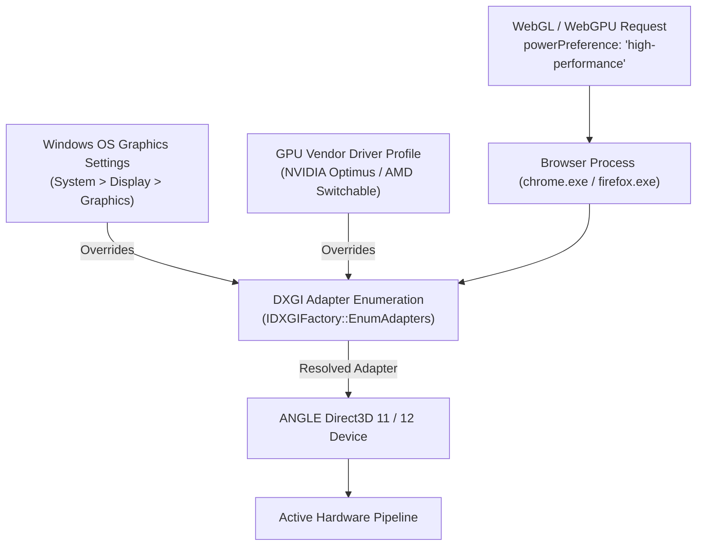

# Dedicated GPU Selection & Cross-Platform Graphics Architecture (WebGL / WebGPU)

Engineering reference on GPU routing, the `powerPreference: "high-performance"` context attribute, OS/driver arbitration boundaries, and cross-platform realities across desktops, laptops, mobile, and tablets.

---

## 1. Ground Truth & Problem Analysis

In the portfolio's 3D engine (`prototype/scene.js:73`), the WebGL renderer is already configured with:
```javascript
renderer = new THREE.WebGLRenderer({ canvas: canvas, antialias: true, powerPreference: "high-performance" });
```
Despite this explicit declaration, the website frequently loads on the integrated GPU (iGPU, e.g. Intel UHD 630) rather than the discrete GPU (dGPU, e.g. NVIDIA RTX) on dual-GPU Windows laptops.

### The Specification Reality: `powerPreference` is a Hint, Not a Command

Both the Khronos WebGL and W3C WebGPU specifications explicitly state that `powerPreference` is purely an advisory hint:

- **Khronos WebGL 2.0 Specification (§5.2.1)**:
  > *"powerPreference provides a hint to the user agent indicating what configuration of GPU is preferred for this WebGL context... The user agent may choose to satisfy this hint or ignore it based on system configuration, battery state, or platform policies."*
- **W3C WebGPU Specification (§3.1)**:
  > *"powerPreference is an adapter selection hint... The user agent MAY choose an adapter matching the preference, but is NOT required to, and MUST NOT fail adapter creation if a matching adapter is unavailable."*

**Core Rule**: There is **no JavaScript API** in any web standard that can force an operating system or driver to activate a discrete GPU. Browsers intentionally enforce this boundary to prevent untrusted web scripts from silently spinning up 100W+ discrete graphics cards, causing thermal spikes and rapid battery drain.

---

## 2. Why Windows Dual-GPU Systems Default to iGPU

On Windows 10 (1803+) and Windows 11, GPU execution is governed by a three-tier hierarchy:



### 1. Windows OS Graphics Performance Preference Override
- Windows assigns all common browser executables (`chrome.exe`, `msedge.exe`, `firefox.exe`, `zen.exe`) to the **"Power saving"** profile by default.
- When Chromium or Gecko initializes its GPU process and calls `IDXGIFactory::EnumAdapters1` with `DXGI_GPU_PREFERENCE_HIGH_PERFORMANCE`, the Windows DWM (Desktop Window Manager) checks the process policy. If set to "Power saving", **DXGI disregards the high-performance preference and returns the integrated adapter**.

### 2. NVIDIA Optimus & AMD Switchable Driver Shims
- The NVIDIA display driver maintains an internal application profile database.
- For browser executables, the driver profile sets `SHIM_RENDERING_MODE_INTEGRATED` to ensure browser UI compositing and video playback do not keep the high-power discrete silicon awake (which drops laptop battery life from 8+ hours to ~1.5 hours).

### 3. Cross-Adapter Copy Penalty
- On laptops without a hardware display MUX (where the internal display panel is wired physically to the iGPU), rendering on the dGPU requires blitting every frame across the PCIe bus into the iGPU's swapchain using `IDXGIKeyedMutex`.
- This introduces a 2–4 ms latency tax and potential PCIe bandwidth contention, leading browser engines to prefer the iGPU unless heavily incentivized.

---

## 3. Cross-Platform & Device Architecture Matrix

Understanding GPU capabilities across device classes is essential for setting realistic performance expectations:

| Platform / Form Factor | Hardware Architecture | `powerPreference: "high-performance"` Behavior | Can Web Page Force dGPU? |
| :--- | :--- | :--- | :--- |
| **Windows Dual-GPU Laptops** (Intel/AMD + NVIDIA RTX/AMD) | Discrete dGPU (PCIe) + Integrated iGPU (die). Optimus / Switchable. | Requests high-performance DXGI adapter; blocked by default Windows OS profile. | **No.** Requires OS or driver override by user. |
| **Windows Desktop PCs** (Monitor connected to dGPU) | Single discrete GPU (iGPU disabled in BIOS or unmonitored). | Always executes on the dGPU (it is the only active display adapter). | **Yes** (by hardware design). |
| **macOS Intel Dual-GPU** (MacBook Pro 15"/16" 2015–2019) | Intel Iris + AMD Radeon dGPU. Managed by AppleGraphicsControl. | Safari and Chrome immediately switch the system multiplexer to the AMD dGPU. | **Yes.** macOS honors the WebGL hint natively. |
| **macOS Apple Silicon** (M1/M2/M3/M4 Max/Pro/Base) | Unified Memory Architecture (UMA). Apple GPU integrated on SoC die. | **No discrete GPU exists.** Single shared silicon die. Acts as DVFS clock hint. | **N/A** (Unified hardware). |
| **Mobile Phones** (iOS / iPhone) | Apple A-series SoC. Unified Memory (UMA). Tile-Based Deferred Rendering (TBDR). | **No discrete GPU exists.** Single Apple GPU core. Acts as DVFS clock hint. | **N/A** (Unified hardware). |
| **Mobile Phones** (Android) | Qualcomm Snapdragon (Adreno), Dimensity (Mali), Tensor. Unified Memory. | **No discrete GPU exists.** Single mobile GPU core. | **N/A** (Unified hardware). |
| **Tablets** (iPadOS, Android Tabs) | Apple M/A-series, Snapdragon. Unified Memory (UMA). | **No discrete GPU exists.** Single mobile GPU core. | **N/A** (Unified hardware). |

### Takeaways for Mobile & Tablets
1. **There is no discrete GPU on mobile or tablet devices.** Every smartphone and tablet operates on a unified SoC where CPU and GPU share the same memory bus and power envelope (typically 2W–6W).
2. **Behavior of `powerPreference` on Mobile**: On iOS and Android, passing `"high-performance"` does not switch graphics cards; instead, it signals the mobile OS's Dynamic Voltage and Frequency Scaling (DVFS) governor to run GPU clock frequencies in higher performance tiers, which risks rapid thermal throttling and battery drain.
3. **Portfolio Strategy Alignment**: Mobile devices are already routed to the non-3D experience via **ADR-0015 (UA-based device delivery)**, completely bypassing WebGL execution on constrained mobile chips. Tablets running iPadOS report desktop UA and run on Apple Silicon's powerful unified GPU, which handles the 3D scene effortlessly.

---

## 4. How to Route Browsers to the dGPU for Local Development & Testing

To test the portfolio scene on the discrete NVIDIA/AMD GPU on Windows:

### Method A: Windows OS Graphics Settings (Recommended)
1. Open **Windows Settings** $\to$ **System** $\to$ **Display** $\to$ **Graphics**.
2. Under "Custom options for applications", select **Desktop app** and click **Browse**.
3. Select your browser executable:
   - Chrome: `C:\Program Files\Google\Chrome\Application\chrome.exe`
   - Zen Browser: `C:\Program Files\Zen Browser\zen.exe` (or user AppData path)
   - Firefox: `C:\Program Files\Mozilla Firefox\firefox.exe`
4. Click **Options** on the added browser entry and change from "Let Windows decide" to **High performance** (pointing to your discrete GPU).
5. Restart the browser completely.

### Method B: NVIDIA Control Panel
1. Open **NVIDIA Control Panel** $\to$ **Manage 3D Settings** $\to$ **Program Settings**.
2. Select or Add your browser executable (`chrome.exe` / `zen.exe`).
3. Set "Preferred graphics processor" to **High-performance NVIDIA processor**.
4. Set "Power management mode" to **Prefer maximum performance**.
5. Click **Apply** and relaunch the browser.

---

## 5. Runtime GPU Verification in WebGL

To verify which GPU is actively executing the scene, query the `WEBGL_debug_renderer_info` extension in the browser console:

```javascript
const canvas = document.createElement("canvas");
const gl = canvas.getContext("webgl2", { powerPreference: "high-performance" });
const ext = gl.getContextAttributes();
const dbg = gl.getExtension("WEBGL_debug_renderer_info");

if (dbg) {
  console.log("Active Vendor:", gl.getParameter(dbg.UNMASKED_VENDOR_WEBGL));
  console.log("Active Renderer:", gl.getParameter(dbg.UNMASKED_RENDERER_WEBGL));
}
```

- **iGPU output**: `Intel(R) UHD Graphics 630` or `AMD Radeon(TM) Graphics`.
- **dGPU output**: `NVIDIA GeForce RTX [Model]` or `AMD Radeon RX [Model]`.

---

## 6. Strategic Architecture Conclusion for Issue #20 & Ticket #22

1. **Keep `powerPreference: "high-performance"`**: The engine should retain this attribute in `prototype/scene.js`. Systems configured to honor high performance (macOS Intel, desktop PCs, or laptops with OS overrides) will automatically use the dGPU.
2. **Do Not Rely on dGPU Presence**: Because public web visitors on dual-GPU laptops and all mobile/tablet users cannot be expected to reconfigure their Windows settings or purchase discrete hardware, **the site must maintain its $\ge 50\text{–}60\text{ fps}$ performance budget on integrated GPUs (Intel UHD 630)**.
3. **Preserve iGPU Optimizations**: Techniques established in **ADR-0010** and **ADR-0016** (Frozen Dwell, diffuse lightmap baking, shadow-map removal, compositor-friendly CSS grain) are the foundation of healthy framerates across the entire user base.

---

## 7. Primary References

- **Khronos Group**: [WebGL 2.0 Specification: Context Creation Attributes](https://registry.khronos.org/webgl/specs/latest/2.0/#5.2.1) · [WEBGL_debug_renderer_info](https://registry.khronos.org/webgl/extensions/WEBGL_debug_renderer_info/)
- **W3C**: [WebGPU Specification (§3.1 GPURequestAdapterOptions)](https://www.w3.org/TR/webgpu/#adapter-selection)
- **Microsoft Learn**: [DirectX Graphics Infrastructure (DXGI): DXGI_GPU_PREFERENCE](https://learn.microsoft.com/en-us/windows/win32/api/dxgi1_6/ne-dxgi1_6-dxgi_gpu_preference) · [Windows Hardware Dev: Hybrid Graphics](https://learn.microsoft.com/en-us/windows-hardware/drivers/display/hybrid-system-dwm-support)
- **Chromium / ANGLE**: [ANGLE: Almost Native Graphics Layer Engine Architecture](https://chromium.googlesource.com/angle/angle/+/main/doc/Architecture.md) · [Chromium GPU Process Initialization (`gpu_init.cc`)](https://source.chromium.org/chromium/chromium/src/+/main:gpu/ipc/service/gpu_init.cc)
- **Apple Developer**: [Metal: Selecting Device Objects on Multi-GPU Systems](https://developer.apple.com/documentation/metal/gpu_selection_in_macos) · [Apple Silicon GPU Architecture Overview](https://developer.apple.com/documentation/apple-silicon/)
