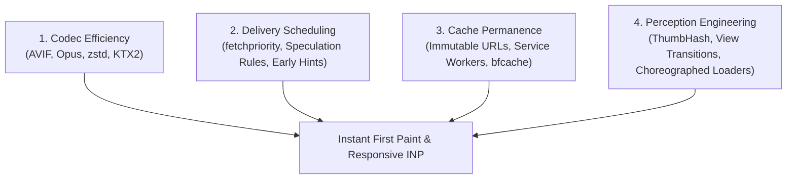

# Modern Web Asset Delivery & Perceived Performance

Engineering reference on loading rich media (3D, audio, images, fonts) with sub-second perceived responsiveness.

## 1. The Four Asset Levers

Sub-second user perception is achieved by decoupling initial interaction from total payload via four levers:



---

## 2. Format & Codec Standards

| Asset Type | Primary Production Standard | Fallback / Notes | Impact vs Legacy |
| :--- | :--- | :--- | :--- |
| **Raster Images** | **AVIF** (`image/avif`) | WebP / JPEG | 40–50% smaller than JPEG at equal SSIM. |
| **Web Audio** | **Opus** (`audio/ogg; codecs=opus`) | AAC / MP3 | Dominates at low bitrates (<32 kbps CBR mono). |
| **Static Text/Code** | **zstd** / **Brotli** (Build-time compressed) | Gzip | 11% better ratio, 42% faster server compression than Brotli. |
| **Web Fonts** | **WOFF2 Variable** (`unicode-range` subset) | Static WOFF2 | Replaces multiple weight files with a single 30–60 KB payload. |
| **3D Geometry** | **glTF 2.0 + meshopt** (`EXT_meshopt_compression`) | Draco | Fast worker-friendly decode; Draco yields higher compression but slower CPU decode. |
| **3D Textures** | **KTX2 / Basis Universal** | PNG / JPG | Textures remain compressed in VRAM (ASTC/BC7); 6–10× download shrink, 4–8× VRAM drop. |

---

## 3. Scheduling & Prioritization APIs

- **`fetchpriority="high"`**: Declare explicitly on exactly the LCP hero element to bypass the browser's default queuing matrix.
- **`loading="lazy"` & `content-visibility: auto`**: Defers paint and rasterization for all elements below the fold until viewport approach.
- **Resource Hints**:
  - `<link rel="preconnect">`: Pre-resolves DNS and TLS for critical third-party hosts (e.g. Google Fonts).
  - `<link rel="preload">` / `<link rel="modulepreload">`: Instructs speculative fetching for current-route critical dependencies.
- **Speculation Rules API**:
  Declarative JSON specifying speculative prerendering on hover or pointerdown for instant zero-RTT navigation:
  ```html
  <script type="speculationrules">
  {
    "prerender": [{ "source": "list", "urls": ["/next-page"] }]
  }
  </script>
  ```

---

## 4. Cache Architecture & Elimination of Redundant Network Trips

- **Immutable Content Hashing**:
  Assets named with content hashes (e.g. `main.a8f2c.js`) served with:
  ```http
  Cache-Control: public, max-age=31536000, immutable
  ```
  Eliminates 304 revalidation roundtrips completely.
- **Back/Forward Cache (bfcache)**:
  Guarantees instant restores on back-navigation by avoiding `unload` listeners and unsupported cache headers.
- **Service Worker Precaching**:
  Caches shell and core assets to disk for offline resilience and zero-network repeat visits.

---

## 5. Perception Engineering

- **ThumbHash Placeholders**:
  Embed tiny (~25-byte) binary representations directly in markup; client unpacks into an accurate blurred canvas preview with aspect ratio and alpha preserved before image bytes arrive.
- **Choreographed Readiness Gating**:
  Render a lightweight CSS loader shell immediately; gate reveal transitions on asset readiness (texture uploads, shader compilations, audio decoding) rather than arbitrary timers.
- **INP & Interaction Discipline**:
  Keep interaction latency $< 200\text{ms}$ by moving heavy parsing, audio synthesis, and lightmap generation off the main thread into Web Workers.

---

## 6. Primary References

- **Standards**: [WHATWG HTML Speculation Rules](https://html.spec.whatwg.org/multipage/nav-history-apis.html#speculative-loading) · [Khronos glTF 2.0](https://www.khronos.org/gltf/) · [KTX2 Specification](https://registry.khronos.org/KTX/specs/2.0/ktxspec.v2.html)
- **Web Platform Performance**: [web.dev LCP Optimization](https://web.dev/articles/optimize-lcp) · [web.dev Priority Hints](https://web.dev/articles/priority-hints) · [MDN View Transition API](https://developer.mozilla.org/en-US/docs/Web/API/View_Transition_API) · [ThumbHash Specification](https://evanw.github.io/thumbhash/)
- **Benchmarks**: [HTTP Archive Web Almanac](https://almanac.httparchive.org/en/2024/page-weight) · [Cloudflare Compression Analysis](https://blog.cloudflare.com/new-standards-for-a-faster-and-more-private-internet/)
